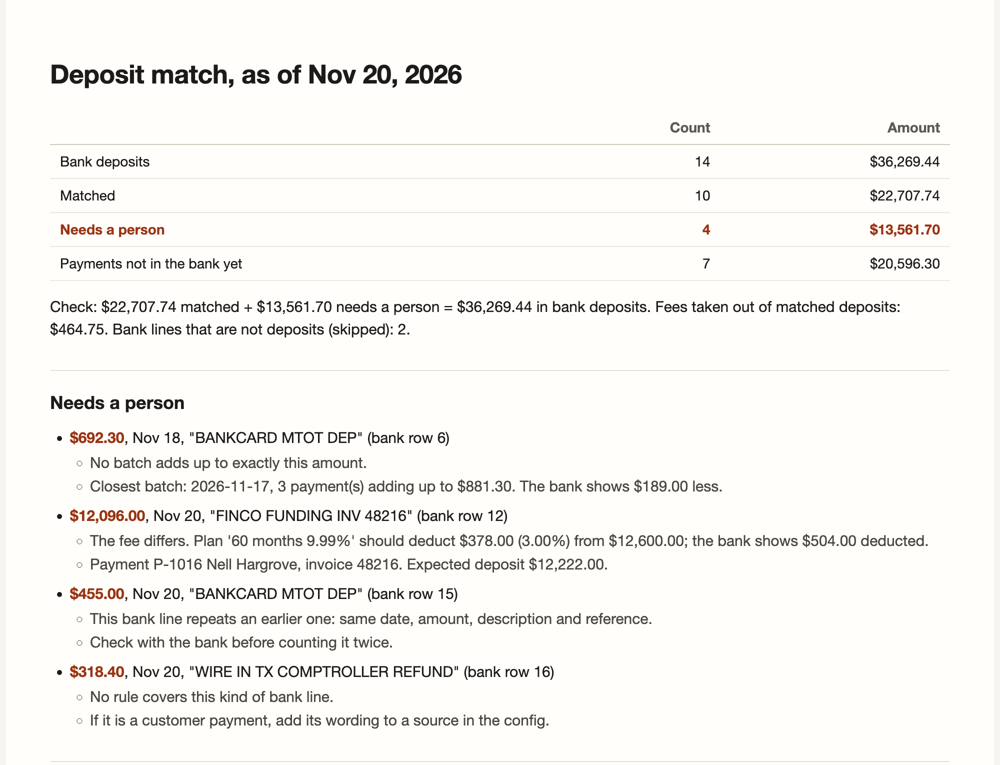

# Service office skills

Four Claude skills for the office of an HVAC and plumbing company. Each one takes a daily or monthly check that someone does by hand, runs it the same way every time, and lists only what a person has to look at.

Written by Christopher Pond Maquidato in November 2026. They run on made-up sample data. The column names, bank wording and fee rates are placeholders until they are set from real exports.

| Skill | The question it answers | Reads |
|---|---|---|
| [`deposit-match`](deposit-match/) | Did every deposit reach the bank, to the cent? | Payments export, bank export |
| [`jobs-review`](jobs-review/) | What was wrong with yesterday's jobs? | Completed jobs export |
| [`financing-fees`](financing-fees/) | Did the financing company deduct the right fee on each loan? | Funding statement, payments export |
| [`routine-watchdog`](routine-watchdog/) | Did every routine run today, and if not, why? | Run log, schedule |



One of the four reports. Each skill's folder shows its own.

## How they are built

The four share the same rules.

- **A script does the work, not the model.** Matching, adding up and deciding a status are done by plain Python in whole cents. Claude runs the script and reports what it found.
- **Read-only.** No skill posts, edits, marks or restarts anything. Each one says what a person should do and stops.
- **Exact or nothing.** There is no tolerance and no best guess. One cent off, two possible answers or a missing rate goes to a person with the numbers shown.
- **Bad input stops the run.** A missing column, a bad amount or a duplicate ID writes no report at all.
- **The totals are proven.** Each script checks that its numbers add up before it writes a report, and refuses to write one if they don't.
- **Three exit codes.** 0 is clean, 1 means something needs a person, 2 means the input couldn't be read. A scheduler can alert on 1 and 2.

Each folder has a `SKILL.md` that Claude reads, the script, a config file, a sample week with the report it produces, and tests.

## Try one

```
cd deposit-match
python3 scripts/match_deposits.py --payments sample-data/payments.csv --bank sample-data/bank.csv --config config.example.json --out /tmp/deposit-match-try
python3 -m unittest discover -s tests
```

Python 3.9 or newer. Nothing to install.

## Install as skills

Copy a skill's folder into `~/.claude/skills/`.

## Not done yet

- Reading ServiceTitan, QuickBooks Online or the bank directly. Every skill works from an export or a log file.
- Sending the alert. The exit codes are there for it; email or chat delivery is not built.
- The web dashboard that would show each person their own list. Every skill writes a `report.json` for it.
