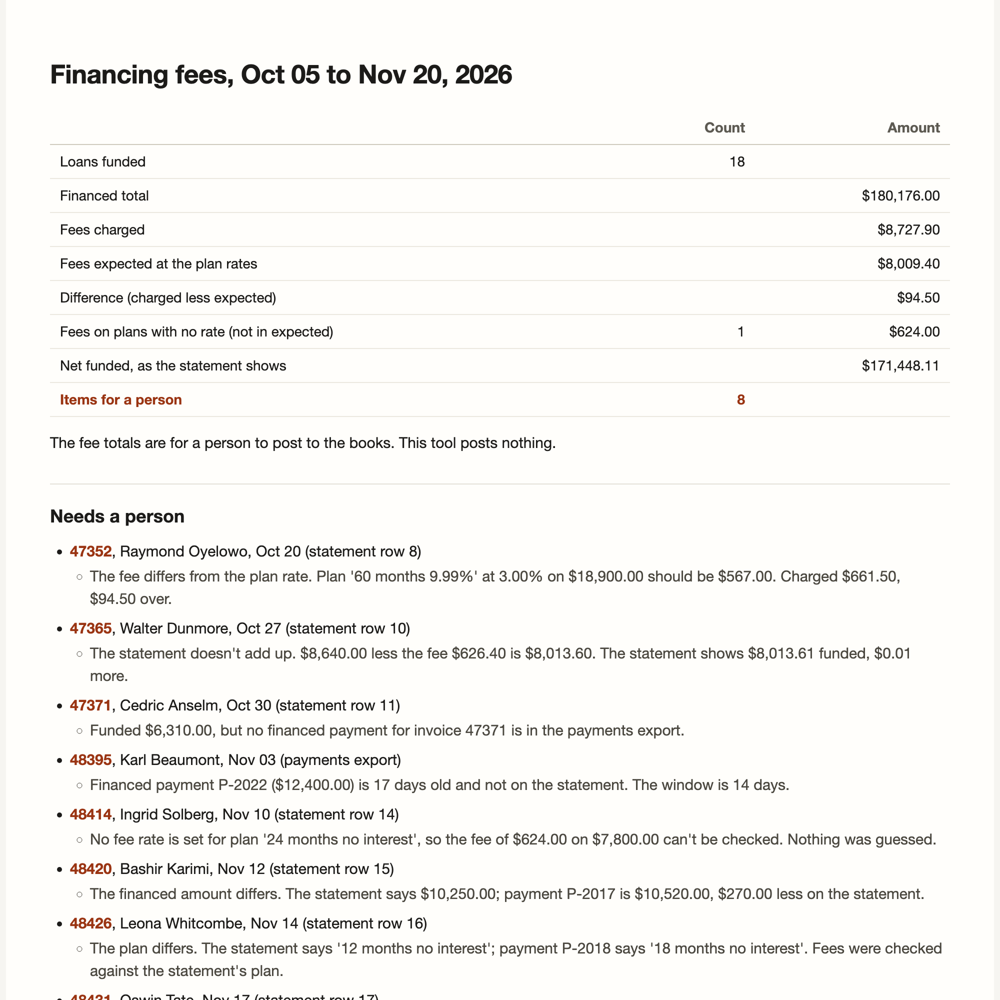

# Financing fees

A Claude skill that checks a financing company's funding statement, loan by loan, and totals the dealer fees. It reads the statement, the plan rates and, if you have it, the payments export. It writes a report. It never posts or changes anything.

Built with Claude Code by Christopher Pond Maquidato in November 2026 for an HVAC and plumbing company's monthly financing check. It runs on made-up sample data. The plan rates in `config.example.json` are placeholders, and the column names are placeholders until they are set from real exports. "Finco" is a made-up financing company.

When a customer finances a job, the financing company pays the contractor the financed amount minus a dealer fee that depends on the plan. This skill checks each fee against the plan's rate, checks the statement's own arithmetic, and compares the statement with the company's financed payments. Then it totals the fees by plan and by month so bookkeeping knows the expense figure.



The report for the sample data. The full file is `sample-data/report/report.md`.

## What's here

| File | What it is |
|---|---|
| `SKILL.md` | What Claude reads: when to use the skill, the rules, the steps |
| `scripts/check_financing_fees.py` | The checks. Plain Python, no packages to install |
| `config.example.json` | Column names, financing payment types, plan rates, funding window |
| `sample-data/` | A made-up statement, matching payments and the report they produce |
| `tests/` | 52 tests |

## Run it

```
python3 scripts/check_financing_fees.py --statement sample-data/funding-statement.csv --payments sample-data/payments.csv --config config.example.json --out sample-data/report
python3 -m unittest discover -s tests
```

The sample gives: 18 lines funded, $180,176.00 financed, fees charged $8,727.90 against $8,009.40 expected, 8 items for a person. See `sample-data/report/report.md`.

## What it checks

- The fee against the plan rate, rounded half up to the cent.
- Financed amount less fee equals net funded.
- A plan with no rate. Flagged, never guessed.
- The same reference funded twice.
- With the payments export: a funded line with no financed payment, a different financed amount, a different plan, and a financed payment that is past the funding window and not on the statement.

## How it keeps wrong numbers out

- **The model doesn't do the arithmetic.** A script does, in whole cents, with Decimal for rates and percentages. Claude runs it and reports.
- **Exact or nothing.** No tolerance. One cent off is flagged, with the numbers and the difference.
- **Never a guess.** A plan with no rate or two payments for one invoice goes to a person.
- **Totals are proved.** The by-plan rows and the by-month rows must each add up to the overall totals, and the statement's own arithmetic is re-added, or the script refuses to write a report.
- **Bad input stops the run.** An unreadable file, a missing column, a bad amount, a bad date or a bad rate writes nothing and exits 2.
- **Read-only.** The fee totals are for a person to post. There is no code path that posts to any system.

## Install as a skill

Copy this folder to `~/.claude/skills/financing-fees/`.

## Not done yet

- Reading ServiceTitan, QuickBooks Online or the financing company's portal directly. It works from CSV exports.
- Reversals, chargebacks and cancelled loans. A line with a zero or negative financed amount stops the run today.
- A loan funded in parts, or several financed payments on one invoice. The second case is flagged for a person; the first is not handled.
- Plan names that change from one statement to the next. Names must match the config, ignoring capitals.
- Promotional or per-loan fee rates that differ from the plan's standard rate. They show up as fee differences.
- Posting the fee expense. That stays with a person, by design.
- The sample statement's layout is invented. A real statement may need different columns, or a different file format.
