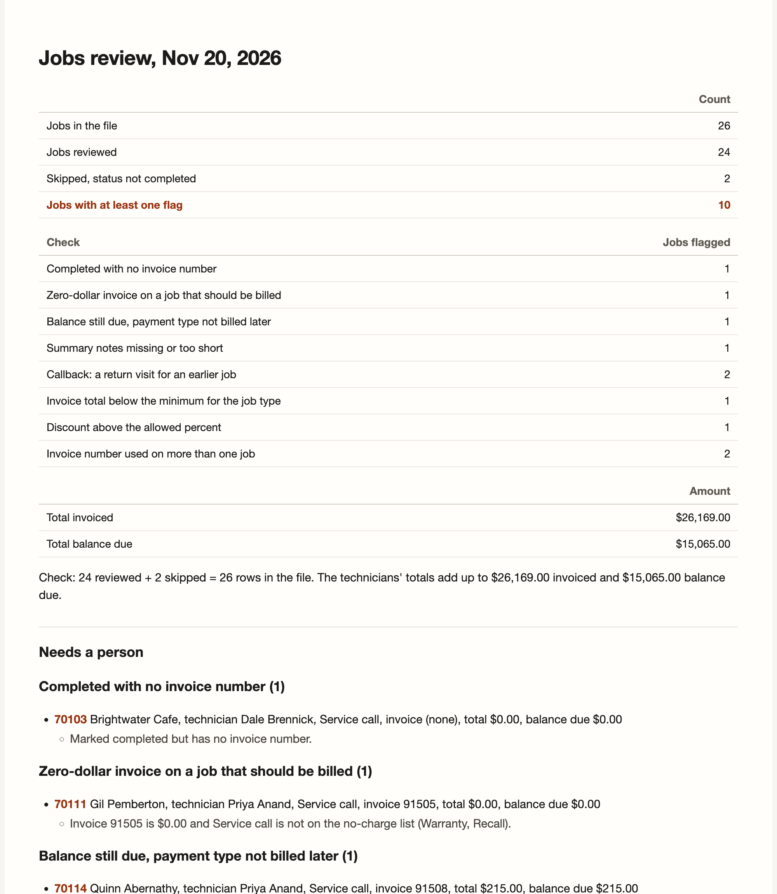

# Jobs review

A Claude skill that reviews a day's completed jobs and lists what a person has to look at, grouped by check and by technician. It reads one CSV export and writes a report. It never edits a job, invoice or anything else.

Built with Claude Code by Christopher Pond Maquidato in November 2026 for an HVAC and plumbing company's daily jobs check. Column names and audit rules are configured in `config.example.json` to match the company's exports.



The report for the sample data. The full file is `sample-data/report/report.md`.

## What's here

| File | What it is |
|---|---|
| `SKILL.md` | What Claude reads: when to use the skill, the rules, the steps |
| `scripts/review_jobs.py` | The checks. Plain Python, no packages to install |
| `config.example.json` | Column names, status and payment type lists, minimums, discount limit |
| `sample-data/` | One day of job exports and the report it produces |
| `tests/` | 49 tests |

## Run it

```
python3 scripts/review_jobs.py --jobs sample-data/jobs.csv --config config.example.json --out sample-data/report
python3 -m unittest discover -s tests
```

The included day gives: 24 jobs reviewed, 2 skipped, 10 flags on 10 jobs. See `sample-data/report/report.md`.

## The checks

1. A completed job with no invoice number.
2. A zero-dollar invoice on a job type that isn't on the no-charge list.
3. A balance still due when the payment type isn't on the billed-later list.
4. Summary notes missing or shorter than the minimum.
5. A callback, with the original job (and its technician and date, if it is in the file).
6. An invoice total below the minimum for its job type.
7. A discount above the allowed percent of the total before the discount.
8. The same invoice number on more than one job.

The report has a summary table, the flagged jobs grouped by check, and the same flags grouped by technician with each person's job count and invoiced total. `report.json` carries the same data, so each technician's list can feed a per-person dashboard.

## How it keeps wrong numbers out

- **The model doesn't do the arithmetic.** A script does, in whole cents. Claude runs it and reports.
- **Every dollar is accounted for.** Reviewed plus skipped must equal the rows in the file, and the technicians' totals must equal the overall totals, or the script refuses to write a report.
- **Bad input stops the run.** A duplicate job number, a bad amount, a bad date, a negative total or a missing column writes nothing and exits 2.
- **Flags are never cleared.** The script lists. A person decides.
- **Read-only.** There is no code path that changes any system.

Exit codes: 0 nothing flagged, 1 something needs a person, 2 the input couldn't be read.

## Install as a skill

Copy this folder to `~/.claude/skills/jobs-review/`.

## Not done yet

- Reading ServiceTitan or QuickBooks Online directly. It works from one CSV export.
- Company-specific column names, job types, payment types, and minimums configured in `config.example.json` to match your own exports.
- The discount check assumes the invoice total is after the discount, so the total before is total plus discount. A system that exports it differently needs a different formula.
- Credits and negative invoice totals. They stop the run today.
- Jobs split across several invoices, or several jobs on one invoice on purpose. Both show as flags or problems today.
- A callback is found only by the recall-of column. A repeat visit that nobody marked as a recall isn't seen.
- A callback's original is looked up only in the same file. It doesn't search earlier days.
- Duplicate invoice numbers are checked among the reviewed jobs only.
- A scheduled daily run and the per-technician dashboard. The exit codes and `report.json` are there for them.
