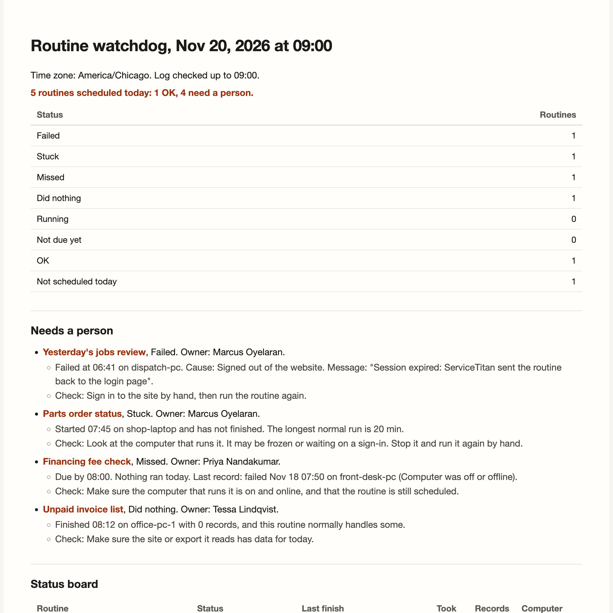

# Routine watchdog

A Claude skill that answers "did every routine run today, and if not, why?" from a run log. It reads the log and a schedule, and writes a report. It never restarts a routine, signs in anywhere or edits the log.

Built with Claude Code by Christopher Pond Maquidato in November 2026 for an HVAC and plumbing company's daily routines. It runs on made-up sample data: the routine names, owners, computer names and failure wording in `routines.example.json` are placeholders until they are set from the real routines.

The problem it addresses: routines depend on websites that sign them out and on office computers that aren't always on. When one stalls, nobody notices until the work is missing.



The report for the sample data. The full file is `sample-data/report/report.md`.

## What's here

| File | What it is |
|---|---|
| `SKILL.md` | What Claude reads: when to use the skill, the rules, the steps |
| `scripts/record_run.py` | A small helper a routine calls to add one line to the run log |
| `scripts/check_routines.py` | The check. Plain Python, no packages to install |
| `routines.example.json` | The schedule: owners, days, due times, longest runs, failure wording |
| `sample-data/` | A week of made-up runs and the report it produces |
| `tests/` | 84 tests |

## Run it

```
python3 scripts/check_routines.py --log sample-data/runs.jsonl --routines routines.example.json --out sample-data/report --now 2026-11-20T09:00:00-06:00
python3 -m unittest discover -s tests
```

The sample day gives: 5 routines scheduled, 1 OK, 4 need a person (one failed because it was signed out, one stuck, one missed because the computer was off, one that handled nothing). One routine only runs on Mondays, so it is listed as not scheduled today. One routine has repeated trouble. See `sample-data/report/report.md`.

## Add it to a routine

Each routine makes two calls: one when it starts and one when it ends. The end call repeats the start time, which is how the check knows the two lines belong to one run.

```
START=$(date +%Y-%m-%dT%H:%M:%S%z)
python3 scripts/record_run.py --log /shared/routines/runs.jsonl --routine "Deposit match" \
  --status started --started "$START" --host "$(hostname -s)"

# ... the routine does its work ...

python3 scripts/record_run.py --log /shared/routines/runs.jsonl --routine "Deposit match" \
  --status ok --started "$START" --finished "$(date +%Y-%m-%dT%H:%M:%S%z)" \
  --records 14 --host "$(hostname -s)"
```

If the routine fails, the second call uses `--status failed` and `--message` with the error in the site's own words, for example `--message "Session expired"`. The routine name must match `routines.json` exactly. Times need an offset; `%z` gives `-0600`, which is accepted.

`record_run.py` only appends. It never rewrites or truncates the log, and it exits non-zero with a message if the line can't be written.

## Schedule the check itself

Run `check_routines.py` once a day after the latest due time, for example at 09:00 on weekdays, from a computer that is always on. Exit code 1 means something needs a person, so the scheduler can act on it. Putting the check on the same computer as the routines would hide the case where that computer is off.

## How it keeps wrong answers out

- **The model doesn't decide.** A script gives each routine exactly one status. Claude runs it and reports.
- **Counts are proved.** Every scheduled routine must have one status, and the status counts must add up to the number of scheduled routines, or the script refuses to write a report.
- **Bad input stops the run.** A line that isn't valid, a time with no offset, a finish before its start, an unknown status, a bad schedule, an unknown timezone or a repeated routine name writes nothing and exits 2. The message names the line.
- **Real moments, not clock readings.** Times are compared as aware times in UTC. A run's length and the "stuck" limit are real minutes, even across a daylight-saving change.
- **Read-only.** The check opens the log for reading and has no code path that restarts anything or signs in anywhere.

## Install as a skill

Copy this folder to `~/.claude/skills/routine-watchdog/`.

## Not done yet

- It only knows what the log says. A routine that never calls `record_run.py` shows as Missed, even if it ran.
- Sending the alert by email or chat is not built. The report and the exit code are there for it.
- A routine that hangs before its first log line can't be told apart from one that never started. Both show as Missed.
- No holidays or one-off days off. A routine scheduled on a holiday shows as Missed.
- A routine that runs several times a day is judged by its latest run, and one due time.
- It doesn't check that a routine's results are right, only that it ran and handled records.
- The two scripts each carry their own copy of the time-reading code, so a change to the time format has to be made in both.
